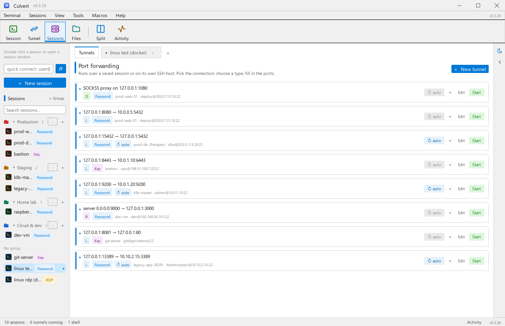

# Culvert


**A modern, native SSH client and port-forwarding manager for the desktop.**
Open shells to any saved host in tabs and run local (`-L`), remote (`-R`) and
dynamic SOCKS5 (`-D`) tunnels — all point-and-click, no commands to remember.
One self-contained `.exe`: no webview, no external SSH binaries.

Built in Rust with [`egui`](https://github.com/emilk/egui) for the interface,
[`russh`](https://github.com/Eugeny/russh) for a pure-Rust SSH client, and a
built-in vt100 terminal emulator so `htop`, `vim` and friends work right in the
app.

## Why "Culvert"?

A culvert is the humble pipe that carries a stream under a road — quiet
infrastructure keeping traffic flowing where you'd never look for it. That's
the job here too: Culvert channels your shells and port forwards through one
small, self-contained tool, out of sight and out of the way.

---

## Features

- **Sessions sidebar** — save host, port, username and auth once; double-click
  any session to open a shell tab (right-click for edit/duplicate/delete).
- **Built-in terminal tabs** — real PTY SSH sessions with 256-colour support,
  scrollback, resize, paste and proper key encoding (Ctrl codes, arrows, F-keys).
  If a session drops you get a reconnect card instead of a dead tab.
- **UI-only tunnel window** — the first tab is a tunnel manager: add Local,
  Remote or Dynamic forwards with plain fields (no `ssh -L` commands anywhere),
  then **Start/Stop each tunnel individually**. Every tunnel runs on its own SSH
  connection, and port conflicts are reported before anything starts.
- **Password or private-key auth** — file picker for keys and optional
  passphrase support.
- **Activity log** — a colour-coded log of connections, forwards and errors,
  opened from the *Activity* button in the status bar.
- **Session search** — filter the sidebar once the list grows.
- **Session groups** — organise sessions into collapsible groups (Production,
  Staging, Home lab…) with colored dots; create, rename, recolor and delete
  groups from the sidebar or a session's right-click menu.
- **Tunnel auto-reconnect** — opt in per tunnel: if the SSH link drops, the
  tunnel comes back on its own with a 3–15s backoff (amber status dot while
  retrying). The switch can be flipped live even while the tunnel is running.
- **Tab management** — right-click any terminal tab: close it, close others,
  close tabs to the right or all of them, browser-style.
- **Modern light theme** — macOS-like white chrome with an indigo accent that
  matches the app icon, a GitHub-style light terminal palette, and bundled
  Inter + JetBrains Mono type system.
- **Light and dark themes** — one click on the *Theme* tile flips the whole
  palette (chrome, cards, terminal canvas included); the choice persists
  across launches.

## Screenshots

**One double-click, one shell** — grouped sessions sidebar opens straight
into a tabbed terminal (real PTY, full colour, scrollback):


**File browser docked in the sidebar** — SFTP listing with upload, folder
create, rename and delete; browsing follows whichever connected tab is
focused:


**Tunnel manager** — Local, Remote and Dynamic forwards as rows with
per-tunnel Start/Stop, auto-reconnect and port-collision guard:


**Light and dark themes** — one click on the *Theme* tile flips the whole
palette (chrome, cards and terminal canvas); the choice persists:




## Download

Grab `culvert-<version>-windows-x64.zip` from the
[Releases](../../releases) page. Every push to `main` builds and publishes a
fresh release automatically (see [Release automation](#release-automation)).

## Quick start

1. Launch `culvert.exe`.
2. Press **New session**, give it a name, host, port, and username.
3. Choose **Password** or **Private key** and fill in the credentials.
4. **Double-click the session** in the sidebar — a shell tab opens and you are
   on the remote machine.
5. Switch to the **Tunnels** tab, press **New tunnel**, pick the session, choose
   Local / Remote / Dynamic and fill in the ports.
6. Press **Start** on the tunnel row — traffic flows. **Stop** any time.

## Understanding the forwards

| Type | Direction | Typical use |
| --- | --- | --- |
| Local `-L` | `listen:8080 → dest:5432` over the server | Reach a service on the remote network through a local port. |
| Remote `-R` | `server listen:9000 → this machine:3000` | Expose something on your machine to the remote server. |
| Dynamic `-D` | `SOCKS5 proxy on 127.0.0.1:1080` | Turn the SSH server into a SOCKS5 proxy for any app. |

The tunnel editor explains the selected type in one line and validates every
field before saving.

## Keyboard shortcuts

| Shortcut | Action |
| --- | --- |
| `Ctrl+N` | New session |
| `Ctrl+T` | New tunnel |
| `Ctrl+V` | Paste into the focused terminal |
| `Ctrl+C` | Interrupt (SIGINT) in the focused terminal — like a real terminal |

## Where your data lives

Sessions (including credentials) are stored as JSON:

- Windows: `%APPDATA%\culvert\sessions.json` (groups live next to it in `groups.json`)
- Linux/macOS: `~/.config/culvert/sessions.json`

Upgrading from an earlier build? Your sessions are imported automatically from
the old `ssh-tunnel-manager` folder the first time Culvert runs.

## Security notes

- Passwords and key passphrases are kept in plain JSON on your machine for reuse
  convenience (the same trade-off desktop SSH clients traditionally make).
  Protect your user profile; consider a dedicated key without a passphrase
  otherwise.
- Unknown server host keys are currently accepted automatically. Pin
  `known_hosts` in `src/ssh.rs` (`check_server_key`) before using this in an
  environment where MITM protection matters.

## Build from source

Prerequisites: [Rust](https://rustup.rs) (stable) and, on Windows, the MSVC
build tools.

```powershell
git clone https://github.com/Shinjiru-stack/culvert
cd culvert
cargo build --release
# → target\release\culvert.exe
```

Run the test suite with `cargo test`. The brand assets (`assets/icon.png`,
`assets/icon.ico`) are generated from the procedural renderer in `src/theme.rs`
and can be regenerated with `cargo test export_brand_assets -- --ignored`.

## Release automation

`.github/workflows/release.yml` runs on every push to `main`:

1. Installs stable Rust and caches the cargo build.
2. Builds the Windows release `.exe` (`cargo build --release --locked`).
3. Packages the `.exe` + docs into `culvert-<version>-windows-x64.zip`.
4. Uploads the zip as a workflow artifact **and** publishes it as a GitHub
   Release tagged `v<version>`.

To cut a new release, bump `version` in `Cargo.toml` and push to `main`; the
workflow tags and publishes that version automatically.

## Project layout

| Path | Purpose |
| --- | --- |
| `src/main.rs` | Window bootstrap (tokio runtime, eframe, icon) |
| `src/theme.rs` | Design system: palette, typography, global style, procedural brand mark |
| `src/app.rs` | UI shell: sessions sidebar, tab bar, tunnels page, modals, toasts |
| `src/terminal.rs` | SSH shell tabs: PTY sessions, vt100 emulation, key encoding |
| `src/ssh.rs` | Shared SSH connect/auth layer (russh client handler) |
| `src/tunnel.rs` | Per-tunnel forward engine: `-L`/`-R`/`-D`, SOCKS5, manager |
| `src/session.rs` | Session/forward models, validation, JSON persistence |
| `src/log.rs` | Activity log types |
| `build.rs` | Embeds the icon + metadata into the Windows `.exe` |
| `assets/` | Brand icon and bundled UI fonts (Inter, JetBrains Mono) |
| `.github/workflows/release.yml` | Build + release pipeline for `main` |

## License

[MIT](LICENSE)
