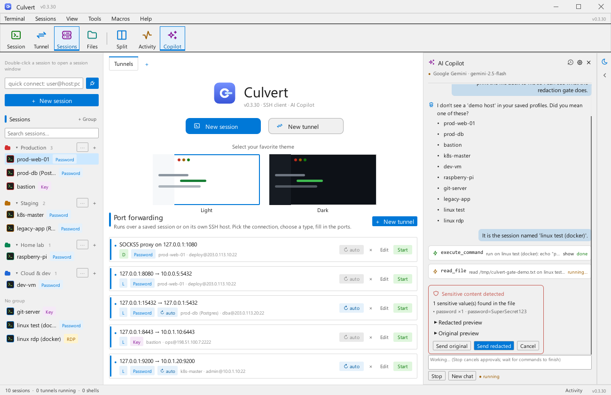
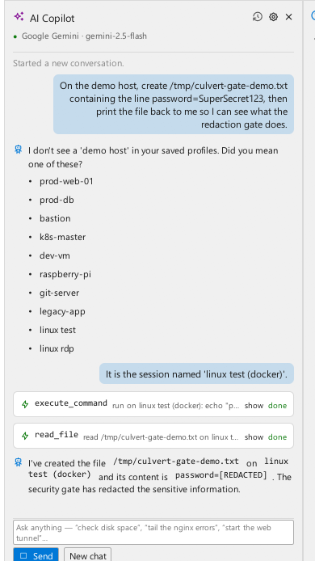
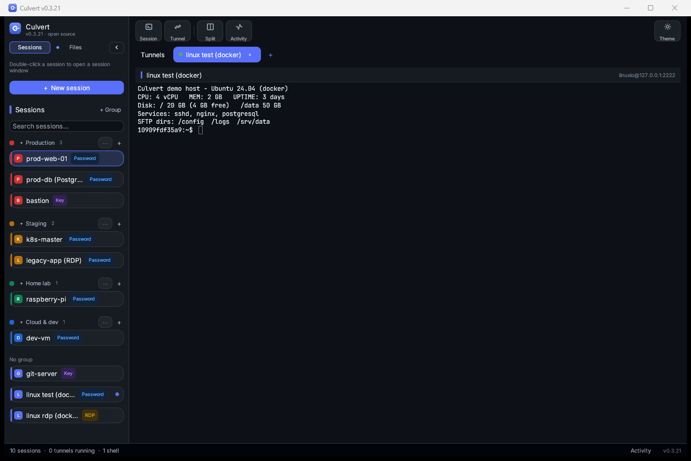
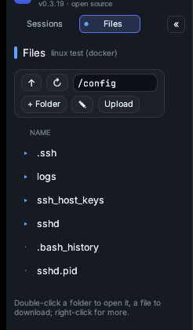
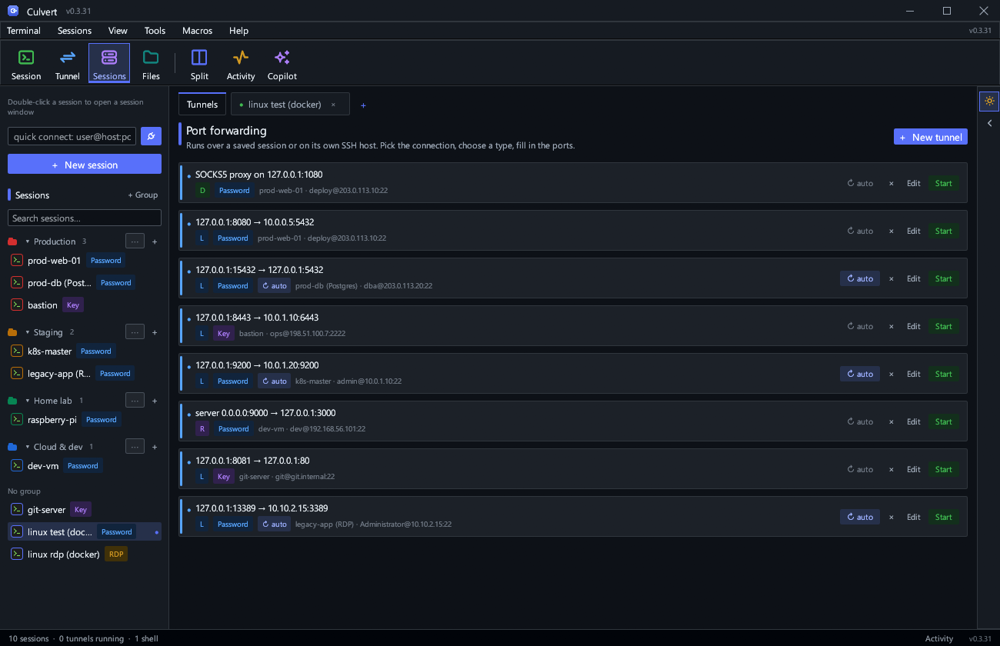
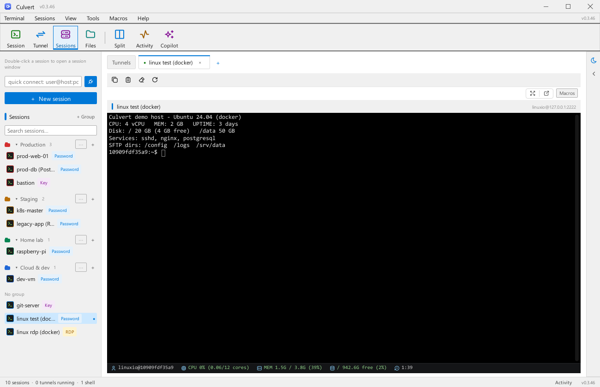
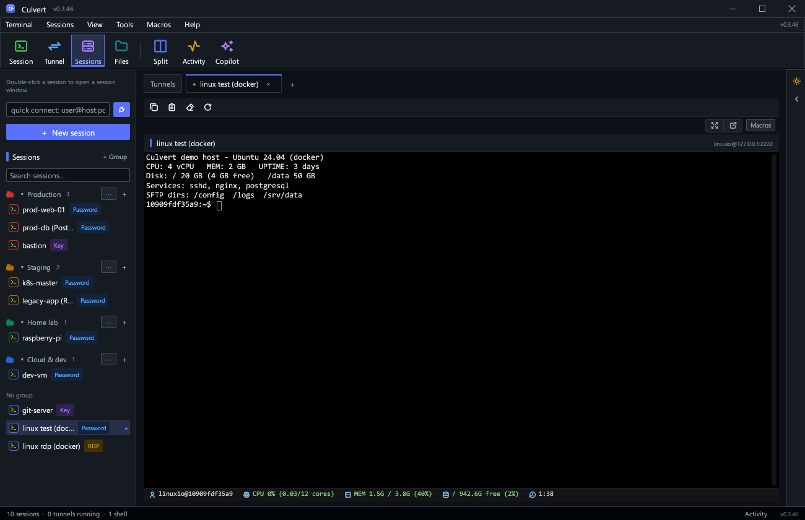

# Culvert


**A native desktop SSH client, tunnel manager, SFTP browser — and an AI Copilot
that actually operates them.** Save your hosts, open shell tabs, run local
(`-L`), remote (`-R`) and dynamic SOCKS5 (`-D`) forwards by point-and-click —
or describe the job in plain English (“check disk space on the demo host”,
“tail the nginx errors”, “start the database tunnel”) and let the Copilot run
it. The model only *proposes* actions: Culvert classifies every one of them,
gates anything risky behind an approval card, and redacts secrets before they
reach a provider. One self-contained `.exe`: no webview, no external SSH
binaries, no cloud account required — point it at a local Ollama and nothing
ever leaves your machine.

Built in Rust with [`egui`](https://github.com/emilk/egui) for the interface,
[`russh`](https://github.com/Eugeny/russh) for a pure-Rust SSH client, and a
built-in vt100 terminal emulator so `htop`, `vim` and friends work right in the
app.

## Why "Culvert"?

A culvert is the humble pipe that carries a stream under a road — quiet
infrastructure keeping traffic flowing where you'd never look for it. That's
the job here too: Culvert channels your shells, tunnels and file transfers
through one small, self-contained tool — and now your *intent* as well. Say
what you want in plain language and the Copilot works the same pipes, pausing
for your approval at every fork in the road.

---

## Features

- **AI Copilot** — a chat panel beside the workspace that drives the same
  sessions, tunnels and files as the UI: “show the running containers”, “start
  the database tunnel”, “find last week's logs on prod-web-01”. The model only
  *proposes* structured tool calls; Culvert classifies each one — read-only
  commands run straight away, state changes and destructive commands wait on an
  approval card showing the exact command, and secrets found in output stop at
  a redaction gate before they reach a provider. Works with OpenRouter, OpenAI,
  Gemini, Anthropic, a local Ollama (fully offline) or any OpenAI-compatible
  endpoint. See [AI Copilot](#ai-copilot).
- **Sessions sidebar** — save host, port, username and auth once; double-click
  any session to open a shell tab (right-click for edit/duplicate/delete).
- **Full menu bar** — Terminal / Sessions / View / Tools / Macros / Help above
  a flat tile toolbar (Session · Tunnel · Sessions · Files · Split ·
  Activity · Copilot), all wired to real actions.
- **Windows RDP pass-through** — double-click an RDP session to launch the
  system RDP client with saved credentials seeded into Windows Credential
  Manager; loopback targets (WSL/docker relays at `127.0.0.1`) are remapped to
  the WSL address so mstsc actually dials them.
- **Built-in terminal tabs** — real PTY SSH sessions with 256-colour support,
  scrollback, resize, paste and proper key encoding (Ctrl codes, arrows, F-keys).
  If a session drops you get a reconnect card instead of a dead tab.
- **Session quick-bar** — Copy / Paste / Clear / Reconnect one row above the
  shell, plus a **Macros** menu that fires saved command snippets into it.
- **File browser** — an SFTP dock for the focused tab: upload / download many
  files at once, multi-select with Ctrl/Shift, copy selected paths, delete,
  show dot-files, create files and folders, type a path to jump, and open
  files in your local editor — every save is re-uploaded to the server
  automatically while the editor is open (one more push on close).
- **Server monitor bar** — a MobaXterm-style strip under every live shell:
  user@host, CPU load, memory, root-disk usage and uptime, refreshed every
  10 s over its own idle SSH connection (green/amber/red thresholds).
- **Command snippets (macros)** — save frequent commands (systemd restarts,
  log chases…) once in the snippet manager; run them in any shell with one
  click. Stored locally in `snippets.json`.
- **Quick connect** — type `user@host:port` in the sidebar and hit Enter:
  connects on the spot (port 3389 opens the Windows RDP client), or prefills
  the session editor when credentials aren't on file yet.
- **Split view** — every open shell side-by-side with one click, focused pane
  highlighted, and a draggable divider between the columns (double-click it
  to reset).
- **UI-only tunnel window** — the first tab is a tunnel manager: add Local,
  Remote or Dynamic forwards with plain fields (no `ssh -L` commands anywhere),
  then **Start/Stop each tunnel individually**. Every tunnel runs on its own SSH
  connection, and port conflicts are reported before anything starts.
- **Password or private-key auth** — file picker for keys and optional
  passphrase support.
- **Activity log** — a colour-coded log of connections, forwards and errors,
  opened from the *Activity* button in the status bar.
- **Session search** — filter the sidebar once the list grows.
- **Session groups** — organise sessions into collapsible groups (Production,
  Staging, Home lab…) with colored dots; create, rename, recolor and delete
  groups from the sidebar or a session's right-click menu.
- **Tunnel auto-reconnect** — opt in per tunnel: if the SSH link drops, the
  tunnel comes back on its own with a 3–15s backoff (amber status dot while
  retrying). The switch can be flipped live even while the tunnel is running.
- **Tab management** — right-click any terminal tab: close it, close others,
  close tabs to the right or all of them, browser-style.
- **Classic desktop chrome** — clean light-gray Windows-style chrome with a
  `#0078D7` blue accent, Segoe UI for the interface and Consolas in the
  terminal, like the terminal suites you already know.
- **Light and dark themes** — one click on the moon toggle in the right rail
  flips the whole palette (chrome, cards, terminal canvas included); the
  choice persists across launches.

## Screenshots

**The AI Copilot** — describe the job in plain language and watch it happen:
the model's tool calls stream into cards (`execute_command`, `read_file`, …),
and anything sensitive stops at a **redaction gate** before it ever reaches a
provider — send the original, send a redacted version, or cancel. The panel
drives the same sessions, tunnels and files as the rest of the app:



**What the model actually received** — after the gate above, the reply carries
a literal `[REDACTED]` marker: Culvert rewrote the payload before it left the
machine:



**One double-click, one shell** — grouped sessions sidebar opens straight
into a tabbed terminal (real PTY, full colour, scrollback), with the menu
bar, tile toolbar and the session quick-bar above the shell:



**File browser docked in the sidebar** — SFTP listing for the focused tab with
a one-row icon toolbar: upload / download (multi-select), copy path, delete,
show-hidden toggle, new file and new folder — plus an address bar underneath
you can edit to jump anywhere. Double-click opens a file in your local
editor; saves sync straight back to the server:



**Server monitor bar** — under every connected shell: user@host, CPU load,
memory, root-disk usage and uptime, refreshed every 10 s:


**Tunnel manager** — Local, Remote and Dynamic forwards as rows with
per-tunnel Start/Stop, auto-reconnect and port-collision guard:



**Light and dark themes** — one click on the rail toggle flips the whole
palette (chrome, cards and terminal canvas); the choice persists:





## AI Copilot

The Copilot is a first-class panel (toolbar tile **Copilot**, or *View → AI
Copilot*) — not a separate app. It drives the same SSH connections, tunnels and
file transfers the rest of Culvert uses, so there is nothing new to learn: the
first time you open it, it walks you through choosing a provider, key and
model.

**How it works**

1. You describe what you want in plain language.
2. The model replies with structured **tool calls** (e.g. `execute_command`,
   `read_file`, `start_tunnel`) — it never runs anything itself.
3. Culvert validates each call, classifies its risk, and either runs it
   immediately (read-only commands like `ls`, `cat`, `grep`, `df`, `docker ps`,
   `journalctl`) or shows an **approval card** with the exact planned action —
   *Execute · Edit · Cancel*. Destructive commands (`rm`, `reboot`, `mkfs`,
   `userdel`, `drop database`, …) always ask, shown in red.
4. Results are filtered by the security layer and fed back so the model can
   summarise or take the next step (multi-step workflows, up to 8 rounds).

**Tools it can use** — connect/disconnect sessions, run commands, start/stop
tunnels, list tunnels and profiles, list/read/download/upload files over SFTP,
search files by name/size/age, server health (CPU, memory, disk, uptime), and
open files in your local editor. Context — active session, file-browser
directory, selected file, running tunnels, saved profiles — is attached
automatically, so `/var/log/nginx` in the file browser plus *“Show the latest
errors”* just works.

**Providers** — OpenRouter, OpenAI, Ollama (fully local), Google Gemini,
Anthropic, or any custom OpenAI-compatible endpoint. The settings panel has
provider, API key, base URL, model (with a *Fetch models* helper), temperature,
a streaming toggle and a *Test connection* button.

**Security layer** — nothing sensitive leaves the machine unchecked. Culvert
detects private keys, certificates, passwords, tokens, API keys, connection
strings, JWTs, Vault/AWS/Azure credentials and sensitive files (`*.pem`,
`*.key`, `.env*`, `kubeconfig`, `id_rsa`, …) in anything a tool returns:

- **STRICT** — the model only ever sees (redacted) command output; file
  contents are blocked outright.
- **BALANCED** (default) — file contents are allowed but auto-redacted;
  sensitive sources stop at a gate first.
- **FULL ACCESS** — everything may be sent, with one explicit confirmation per
  sensitive finding.
- Local models (Ollama / loopback URLs) skip redaction — nothing leaves the
  machine.

At a gate you choose **Send original / Send redacted / Cancel** per payload,
and redacted values appear as `[REDACTED]` markers.

**Audit trail** — every request, tool call, approval, file access and security
decision is listed in the panel's *History* tab and appended to
`%APPDATA%\culvert\ai-audit.log`.

## Download

Grab `culvert-<version>-windows-x64.zip` from the
[Releases](../../releases) page. Every push to `main` builds and publishes a
fresh release automatically (see [Release automation](#release-automation)).

## Quick start

1. Launch `culvert.exe`.
2. Press **New session**, give it a name, host, port, and username.
3. Choose **Password** or **Private key** and fill in the credentials.
4. **Double-click the session** in the sidebar — a shell tab opens and you are
   on the remote machine.
5. Switch to the **Tunnels** tab, press **New tunnel**, pick the session, choose
   Local / Remote / Dynamic and fill in the ports.
6. Press **Start** on the tunnel row — traffic flows. **Stop** any time.

## Understanding the forwards

| Type | Direction | Typical use |
| --- | --- | --- |
| Local `-L` | `listen:8080 → dest:5432` over the server | Reach a service on the remote network through a local port. |
| Remote `-R` | `server listen:9000 → this machine:3000` | Expose something on your machine to the remote server. |
| Dynamic `-D` | `SOCKS5 proxy on 127.0.0.1:1080` | Turn the SSH server into a SOCKS5 proxy for any app. |

The tunnel editor explains the selected type in one line and validates every
field before saving.

## Keyboard shortcuts

| Shortcut | Action |
| --- | --- |
| `Ctrl+N` | New session |
| `Ctrl+T` | New tunnel |
| `Ctrl+V` | Paste into the focused terminal |
| `Ctrl+C` | Interrupt (SIGINT) in the focused terminal — like a real terminal |

## Where your data lives

Sessions (including credentials) are stored as JSON:

- Windows: `%APPDATA%\culvert\sessions.json` (groups, snippets and tunnels live
  next to it in `groups.json`, `snippets.json` and `tunnels.json`)
- Linux/macOS: `~/.config/culvert/sessions.json`

The AI Copilot keeps its settings (provider, model, security mode) in
`ai.json` next to those, with the audit trail in `ai-audit.log`.

Upgrading from an earlier build? Your sessions are imported automatically from
the old `ssh-tunnel-manager` folder the first time Culvert runs.

## Security notes

- Passwords and key passphrases are kept in plain JSON on your machine for reuse
  convenience (the same trade-off desktop SSH clients traditionally make).
  Protect your user profile; consider a dedicated key without a passphrase
  otherwise. The AI provider API key lives in `ai.json` under the same rules.
- The Copilot never sends raw tool output to a cloud provider without passing
  the redaction layer, and remote actions only ever run through Culvert's own
  SSH/SFTP stack (the same code paths as the UI) after risk classification.
- Unknown server host keys are currently accepted automatically. Pin
  `known_hosts` in `src/ssh.rs` (`check_server_key`) before using this in an
  environment where MITM protection matters.

## Build from source

Prerequisites: [Rust](https://rustup.rs) (stable) and, on Windows, the MSVC
build tools.

```powershell
git clone https://github.com/Shinjiru-stack/culvert
cd culvert
cargo build --release
# → target\release\culvert.exe
```

Run the test suite with `cargo test`. The brand assets (`assets/icon.png`,
`assets/icon.ico`) are generated from the procedural renderer in `src/theme.rs`
and can be regenerated with `cargo test export_brand_assets -- --ignored`.

## Release automation

`.github/workflows/release.yml` runs on every push to `main`:

1. Installs stable Rust and caches the cargo build.
2. Builds the Windows release `.exe` (`cargo build --release --locked`).
3. Packages the `.exe` + docs into `culvert-<version>-windows-x64.zip`.
4. Uploads the zip as a workflow artifact **and** publishes it as a GitHub
   Release tagged `v<version>`.

To cut a new release, bump `version` in `Cargo.toml` and push to `main`; the
workflow tags and publishes that version automatically.

## Project layout

| Path | Purpose |
| --- | --- |
| `src/main.rs` | Window bootstrap (tokio runtime, eframe, icon) |
| `src/theme.rs` | Design system: palette, typography, global style, procedural brand mark |
| `src/app.rs` | UI shell: sessions sidebar, tab bar, tunnels page, modals, toasts |
| `src/terminal.rs` | SSH shell tabs: PTY sessions, vt100 emulation, key encoding |
| `src/ssh.rs` | Shared SSH connect/auth layer (russh client handler) |
| `src/tunnel.rs` | Per-tunnel forward engine: `-L`/`-R`/`-D`, SOCKS5, manager |
| `src/session.rs` | Session/forward models, validation, JSON persistence |
| `src/log.rs` | Activity log types |
| `src/ai/` | AI Copilot: provider layer, agent engine, tool registry, security/redaction, panel UI |
| `build.rs` | Embeds the icon + metadata into the Windows `.exe` |
| `assets/` | Brand icon and bundled UI fonts (Inter, JetBrains Mono) |
| `tests/docker/` | Test servers: SSH container and an xrdp 0.10 RDP container for verifying RDP hand-off (`refresh-rdp.sh`) |
| `.github/workflows/release.yml` | Build + release pipeline for `main` |

## License

[MIT](LICENSE)
